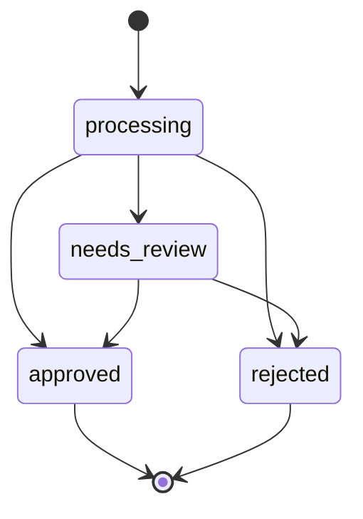

# Mini Invoice Approval Desk

A small internal tool for reviewing vendor invoices: invoices arrive as "processing", get flagged
for review automatically when they look like a duplicate, and an approver either approves or
rejects them (with a required reason) from a simple web UI. Built as a NestJS + TypeORM API in
front of Postgres, with a React + Vite frontend and a Swagger-documented REST contract between
them.

## Prerequisites

- Node.js 20+
- Docker (for Postgres via `docker compose`)

## Quick start

```bash
docker compose up -d        # starts Postgres 16 on localhost:5434
npm install                 # installs both workspaces (server + web)
npm run db:migrate           # creates the schema
npm run db:seed              # inserts 6 realistic sample invoices
npm run dev                  # runs the API and the web app together
```

| App          | URL                                |
| ------------ | ----------------------------------- |
| Web app      | http://localhost:5173               |
| API          | http://localhost:3000/api           |
| Swagger docs | http://localhost:3000/api/docs      |

Running tests:

```bash
npm test                     # unit tests (server)
npm run test:e2e             # e2e tests against a separate test database
```

`npm run test:e2e` automatically creates the `invoice_desk_test` database (in the same
docker-compose Postgres instance) and runs migrations against it before the suite starts — no
extra setup needed beyond having a `.env.test` (see below).

## Environment variables

Copy `.env.example` to `.env` (and `.env.test.example` to `.env.test` if you want to run the e2e
suite) before running anything. One `.env` at the repo root is shared by docker-compose, the API,
and the web app (Vite is configured with `envDir: '../'`).

| Variable       | Used by              | Description                                                        |
| -------------- | --------------------- | -------------------------------------------------------------------- |
| `DB_HOST`      | API, docker-compose   | Postgres host (`localhost` for local dev)                           |
| `DB_PORT`      | API, docker-compose   | Postgres port. Defaults to `5434` on the host to avoid clashing with a locally-installed Postgres on `5432` |
| `DB_USERNAME`  | API, docker-compose   | Postgres user                                                        |
| `DB_PASSWORD`  | API, docker-compose   | Postgres password                                                    |
| `DB_NAME`      | API, docker-compose   | Database name                                                        |
| `API_PORT`     | API                   | Port the Nest server listens on                                     |
| `WEB_ORIGIN`   | API                   | Origin allowed by CORS (the Vite dev server)                        |
| `VITE_API_URL` | web                   | Base URL the frontend calls, e.g. `http://localhost:3000/api`       |

`.env.test` (see `.env.test.example`) mirrors the same shape but points at a separate
`DB_NAME` so e2e tests never touch your dev data.

## Project structure

```
.
├── docker-compose.yml        # Postgres 16
├── .env.example / .env.test.example
├── server/                   # NestJS API
│   └── src/
│       ├── app.module.ts
│       ├── config/            # env loading
│       ├── common/            # exception filter + AppException
│       ├── database/          # TypeORM data-source, migrations, seed script
│       ├── health/            # GET /api/health
│       └── invoices/          # entities, service, controller, DTOs,
│                               # duplicate-detector.ts, status-transitions.ts
└── web/                      # React + Vite SPA
    └── src/
        ├── api/               # typed fetch client
        ├── types/             # types mirroring the backend DTOs
        ├── hooks/             # TanStack Query hooks + toast context
        ├── components/        # Header, TabNav, StatusBadge, RejectDialog, ToastProvider
        └── pages/             # InvoiceListPage, InvoiceDetailPage
```

## API reference

All routes are prefixed with `/api`. Full interactive docs (request/response schemas) are at
`/api/docs`.

### `GET /api/invoices?status=<status>`

`status` is optional: `processing` | `needs_review` | `approved` | `rejected` | `decided`
(`decided` returns approved + rejected together). Omit it to get everything. Sorted by
`createdAt` descending.

```bash
curl http://localhost:3000/api/invoices?status=needs_review
```

```json
[
  {
    "id": "504b0e5d-78e0-4206-a7eb-9c1ce8169f30",
    "invoiceNumber": "INV-20561",
    "vendorName": "Riverbend Electrical Contracting",
    "amountCents": 825075,
    "currency": "USD",
    "issueDate": "2026-09-05",
    "dueDate": "2026-10-05",
    "status": "needs_review",
    "duplicateOfId": "151d1d5f-490c-4488-9c01-92c799fef841",
    "createdAt": "2026-10-06T10:03:07.121Z",
    "updatedAt": "2026-10-06T10:03:07.121Z"
  }
]
```

### `GET /api/invoices/counts`

```bash
curl http://localhost:3000/api/invoices/counts
```

```json
{ "processing": 2, "needs_review": 1, "decided": 2 }
```

### `GET /api/invoices/:id`

Returns the full invoice, a `duplicateOf` summary when applicable, and the status history
oldest-first. 404 if the id doesn't exist, 400 if it isn't a valid UUID.

```bash
curl http://localhost:3000/api/invoices/504b0e5d-78e0-4206-a7eb-9c1ce8169f30
```

```json
{
  "id": "504b0e5d-78e0-4206-a7eb-9c1ce8169f30",
  "invoiceNumber": "INV-20561",
  "vendorName": "Riverbend Electrical Contracting",
  "amountCents": 825075,
  "currency": "USD",
  "issueDate": "2026-09-05",
  "dueDate": "2026-10-05",
  "status": "needs_review",
  "duplicateOfId": "151d1d5f-490c-4488-9c01-92c799fef841",
  "createdAt": "2026-10-06T10:03:07.121Z",
  "updatedAt": "2026-10-06T10:03:07.121Z",
  "description": "Rough-in electrical for units 4-6, Maple Street townhomes.",
  "reviewNote": "Possible duplicate of invoice INV-20561 from Riverbend Electrical Contracting.",
  "duplicateOf": {
    "id": "151d1d5f-490c-4488-9c01-92c799fef841",
    "invoiceNumber": "INV-20561",
    "vendorName": "Riverbend Electrical Contracting"
  },
  "statusHistory": [
    {
      "id": "e669c3c2-afa1-4baa-8a74-38692e41af86",
      "fromStatus": null,
      "toStatus": "needs_review",
      "note": "Flagged automatically by duplicate detection.",
      "changedAt": "2026-10-06T10:03:07.121Z"
    }
  ]
}
```

### `PATCH /api/invoices/:id/status`

Body: `{ "status": "approved" | "rejected" | "needs_review", "note"?: string }`. `note` is
required (and must be non-empty) when rejecting; optional otherwise.

```bash
curl -X PATCH http://localhost:3000/api/invoices/<id>/status \
  -H 'Content-Type: application/json' \
  -d '{"status":"rejected","note":"Amount does not match the signed PO."}'
```

Error responses share one shape:

```json
{ "error": { "code": "NOTE_REQUIRED", "message": "A non-empty note is required when rejecting an invoice", "statusCode": 400 } }
```

```json
{ "error": { "code": "INVALID_TRANSITION", "message": "Cannot transition invoice from \"approved\" to \"rejected\"", "statusCode": 409 } }
```

### `GET /api/health`

```bash
curl http://localhost:3000/api/health
# {"ok":true,"db":"up"}
```

## Schema

**`invoices`**

| Column            | Type                        | Notes                                                |
| ----------------- | --------------------------- | ----------------------------------------------------- |
| `id`               | `uuid`, PK                  | `gen_random_uuid()`                                   |
| `invoice_number`   | `varchar`                   |                                                         |
| `vendor_name`      | `varchar`                   |                                                         |
| `amount_cents`     | `integer`                   | money as integer cents — see below                     |
| `currency`         | `char(3)`                   | default `'USD'`                                        |
| `issue_date`       | `date`                      |                                                         |
| `due_date`         | `date`                      |                                                         |
| `description`      | `text`                      |                                                         |
| `status`           | `invoice_status_enum`       | `processing` \| `needs_review` \| `approved` \| `rejected`, default `processing` |
| `duplicate_of_id`  | `uuid`, nullable, FK → `invoices.id` | set when flagged as a duplicate                |
| `review_note`      | `text`, nullable            | latest approve/reject/flag note                        |
| `created_at`       | `timestamptz`                |                                                         |
| `updated_at`       | `timestamptz`                |                                                         |

Index: `(lower(vendor_name), invoice_number)` — speeds up the duplicate lookup (case/whitespace
-insensitive vendor match + exact invoice number). It is **deliberately not unique**: a real
duplicate invoice must still be *storable* so a human can review and reject it — rejecting the
insert at the database layer would mean the duplicate never shows up in the "Needs review" tab at
all.

Money is stored as an **integer number of cents**, never a float. Floating-point types can't
represent amounts like `$0.10` exactly, and repeated arithmetic on them accumulates rounding
error — unacceptable for anything involving money. Integer cents are exact and trivially
formatted for display with `Intl.NumberFormat`.

**`invoice_status_history`**

| Column        | Type                   | Notes                                   |
| ------------- | ---------------------- | ----------------------------------------- |
| `id`           | `uuid`, PK             |                                            |
| `invoice_id`   | `uuid`, FK → `invoices.id`, `ON DELETE CASCADE` |                        |
| `from_status`  | `invoice_status_enum`, nullable | `null` on the row created at invoice creation |
| `to_status`    | `invoice_status_enum`  |                                            |
| `note`         | `text`, nullable       |                                            |
| `changed_at`   | `timestamptz`           |                                            |

## Status model

- **processing** — just ingested, no action taken yet.
- **needs_review** — flagged automatically (currently: duplicate detection) and waiting on a
  human decision.
- **approved** — terminal. Payment can proceed.
- **rejected** — terminal. Always carries a `review_note` explaining why.



`approved` and `rejected` are final: any further `PATCH .../status` on them returns `409
INVALID_TRANSITION`. Rejecting without a non-empty `note` returns `400 NOTE_REQUIRED` before the
transition is even checked.

**Duplicate detection**: when an invoice is created, `DuplicateDetectorService` looks for an
existing invoice where `lower(trim(vendor_name))` matches and `invoice_number` matches exactly
(using the index above). If found, the new invoice is saved with `status = needs_review` and
`duplicate_of_id` pointing at the original, and a status-history row records the auto-flag. The
UI surfaces this as a "Possible duplicate" badge in the list and a link to the original on the
detail page.

## Design decisions and trade-offs

- **Module boundaries**: `DatabaseModule` owns the TypeORM connection, `InvoicesModule` owns
  everything invoice-related (entities, service, controller, DTOs, duplicate detection, status
  rules), `HealthModule` is a thin wrapper around `@nestjs/terminus`. Controllers only translate
  HTTP ↔ DTOs; all business logic (duplicate matching, transition rules, transactions) lives in
  services so it's unit-testable without an HTTP layer.
- **Migrations, not `synchronize: true`**: `synchronize` is convenient but silently drops/alters
  columns based on entity changes — not something you want once there's real data. A single
  hand-written migration here gives full control over the enum, the functional index, and the
  foreign keys, and is the same workflow you'd use against a production database.
- **Transactions + row locking for status changes**: `updateStatus` runs inside
  `DataSource.transaction` with a `pessimistic_write` lock on the invoice row before validating
  the transition and writing the history row. Without the lock, two concurrent approve/reject
  requests for the same invoice could both read "processing", both pass validation, and both
  write — corrupting the history. The lock serializes them so the second request sees the
  already-updated status and correctly gets a 409.
- **One root `.env`**: docker-compose, the API, and the web app (via Vite's `envDir`) all read
  the same file instead of three separate ones, so there's exactly one place to configure a port
  or credential.
- **Plain CSS over a UI library**: the UI surface area is small (a tab list, a row list, a detail
  page, one dialog) — a component library would add more weight than it saves.

## What I'd add with more time

- Auth and roles (who can approve vs. who can only flag for review), with the actor recorded on
  each status-history row instead of just the status transition.
- Pagination/virtualization on the invoice list once volumes grow past a page or two.
- Invoice PDF upload + OCR to auto-populate vendor/amount/invoice number instead of manual entry.
- Multi-step approvals (e.g. manager sign-off above a dollar threshold) by extending the status
  state machine rather than reworking it.
- An audit trail keyed by user, and a "reopen" path for an accidentally-rejected invoice that
  still preserves the original history instead of mutating it.
